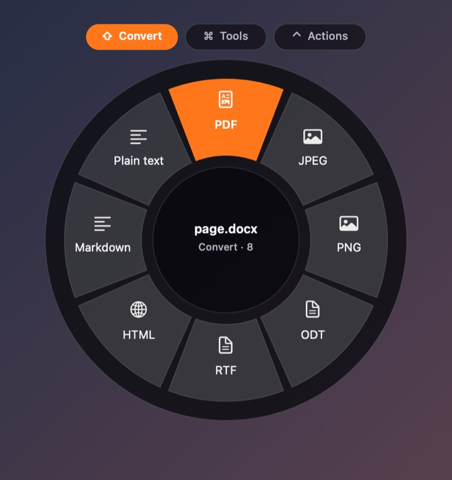
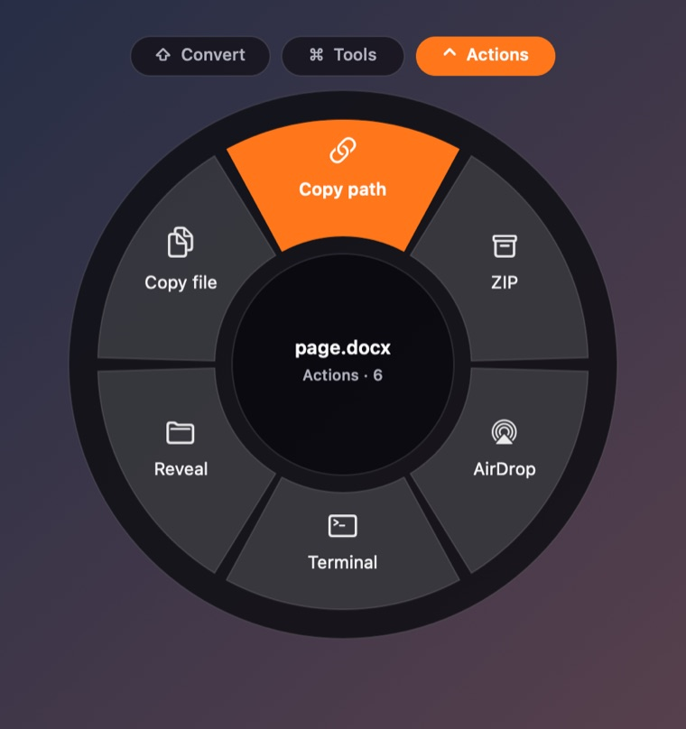
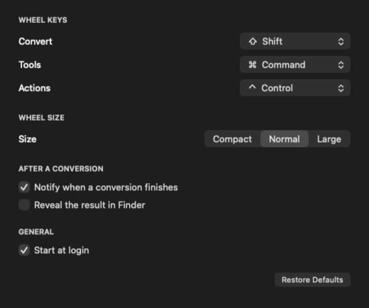

# Mandarina

Drag a file, tap a key, drop it on a format. A radial menu for converting
files on your Mac, powered by [convt](https://github.com/opencoredev/convt).
Nothing is uploaded.



## What it does

While you drag a file in Finder, tap a modifier and a wheel opens under the
cursor. Move to a wedge and let go.

| Key | Wheel | Offers |
| --- | --- | --- |
| `⇧` | Convert | The formats convt can reach from that file |
| `⌘` | Tools | Compress, resize, thumbnail, flatten, mute, audio only, GIF, first page, 300 DPI, plain text |
| `⌃` | Actions | Copy path, copy file, reveal, terminal, AirDrop, ZIP |



Keys are configurable, and the wheel stays open after you release the
modifier, until you drop the file or move back to the centre.

## Requirements

- macOS 13 or later, Apple silicon.
- **[convt](https://github.com/opencoredev/convt)** on the machine. Mandarina
  is a front end: all conversion happens in convt's engines (FFmpeg, PDFium,
  LibreOffice, image, resvg). A packaged convt starts a 7 day trial; building
  it from source is unrestricted.
- **LibreOffice** if you want documents, spreadsheets and slides. convt uses it
  for those, and its macOS build does not bundle a document pack.

Mandarina checks for convt in `/Applications/convt.app`, Homebrew and `PATH`.

## Install

1. Download `Mandarina-<version>.dmg` from
   [Releases](../../releases) and open it.
2. Drag **Mandarina** to Applications.
3. The build is signed ad-hoc, not notarized, so Gatekeeper blocks the first
   launch. Right-click the app, choose **Open**, then **Open** again. On recent
   macOS you may need System Settings → Privacy & Security → **Open Anyway**.

Or from a terminal:

```sh
xattr -dr com.apple.quarantine /Applications/Mandarina.app
open /Applications/Mandarina.app
```

Mandarina lives in the menu bar (hexagon icon, no Dock icon) and adds itself to
login items on first launch.

## Settings

Menu bar → **Settings…**



- **Wheel keys**: which modifier opens each wheel (`⇧ ⌘ ⌃ ⌥`). Picking a key
  another wheel owns swaps them, so no wheel is ever left without one.
- **Wheel size**: Compact, Normal or Large.
- **After a conversion**: floating confirmation and reveal in Finder. Errors
  always surface, even with notifications off.
- **Start at login**.

## No permissions

The drag flow asks for nothing: no Accessibility, no Input Monitoring, no
screen recording. Instead of an event tap, Mandarina polls the session state at
40 Hz (`CGEventSource.buttonState`, `flagsState`, `keyState`,
`NSEvent.mouseLocation`) and reads the dragged file from the system drag
pasteboard. Those are read-only queries that need no TCC grant.

The one exception is *Show wheel for selection* in the menu bar, which reads
the Finder selection through AppleScript and asks for Automation permission the
first time.

## Build from source

Xcode command line tools are enough. No Xcode project, no dependencies.

```sh
./build.sh                  # build/Mandarina.app, ad-hoc signed
open build/Mandarina.app
```

Sign with your own identity while developing, so the Automation grant survives
rebuilds:

```sh
MANDARINA_SIGN_IDENTITY="Apple Development: you@example.com (XXXXXXXXXX)" ./build.sh
```

Build the disk image:

```sh
./scripts/make-dmg.sh       # dist/Mandarina-<version>.dmg
```

## Release

Push a tag. The workflow in `.github/workflows/release.yml` builds the app on a
macOS runner, packages the DMG, and attaches it to the release.

```sh
git tag v1.0.0
git push --tags
```

Bump `VERSION` and tag the same number.

## How it works

| File | Job |
| --- | --- |
| `Sources/StateMonitor.swift` | Polls button, modifiers and pointer |
| `Sources/WheelController.swift` | Panel lifetime, items per mode, applies the choice |
| `Sources/WheelView.swift` | Draws the ring, mode pills, angle to segment |
| `Sources/WheelModel.swift` | What each wheel offers and in what order |
| `Sources/Convt.swift` | Bridge to the convt CLI |
| `Sources/FileResolver.swift` | Files from the drag pasteboard, Finder selection |
| `Sources/Settings.swift` | `UserDefaults` store and key swapping |
| `Sources/SettingsWindowController.swift` | The settings pane |

Two details worth knowing:

- The drag pasteboard keeps its contents after a drag ends, so Mandarina records
  its `changeCount` while idle and ignores anything that has not changed since.
  A long press without a drag does not open the wheel on a stale file.
- Same-format tools (compress, resize, flatten) convert into a temporary
  directory and are renamed to `name-suffix.ext`, so the original is never
  overwritten and you do not end up with `file (3).png`.

## Known limits

- Builds are not notarized: the first launch needs the Gatekeeper step above.
- Conversions need convt installed. Without it the convert wheel says so and
  the other wheels still work.
- During a drag the panel cannot become key, so arrow keys and `Enter` only work
  in the wheel opened from the menu bar.
- Apple silicon only.

## Test hooks

The app can drive itself, which is how it is tested without a mouse:

```sh
B=build/Mandarina.app/Contents/MacOS/Mandarina
$B --hit --mode convert file.docx            # every wedge maps back to its index
$B --render /tmp/wheel.png --mode tools x.png
$B --simulate file.docx --pick pdf           # full conversion, no window
$B --settings-shot /tmp/settings.png
$B --settings-check                          # key swap and scale
```

## Credits

The drag, tap, drop interaction is inspired by
[Tangerine for Mac](https://tangerineformac.com). Conversions are
[convt](https://github.com/opencoredev/convt), AGPL-3.0. The wheel, the app and
this repository share no code with either.

## License

MIT. See [LICENSE](LICENSE).
